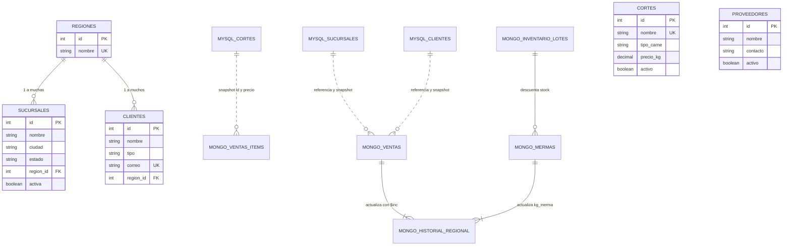

# 🥩 Diseño y Justificación de Bases de Datos

## 1. Justificación Arquitectónica: Modelo Híbrido Políglota

El sistema resuelve la necesidad de una carnicería multirregional donde conviven dos necesidades de datos:
1. **Datos de configuración y maestros (MySQL):** Requieren integridad referencial estricta, claves foráneas, unicidad y consistencia ACID estándar. Catálogos como regiones, sucursales, cortes de carne y clientes rara vez cambian su esquema y tienen volúmenes moderados.
2. **Datos operacionales y analíticos de rápido crecimiento (MongoDB):**
   - **Ventas con snapshots:** Una venta contiene una cantidad variable de cortes con sus precios congelados al momento de la venta. Si el precio de un corte cambia mañana en el catálogo de MySQL, el historial de ventas jamás debe modificarse.
   - **Inventario por Lotes (FIFO):** Rotación de lotes basada en fecha de caducidad.
   - **Mermas operativas:** Registro flexible de pérdidas con motivos e incidentes.
   - **Historial Regional Precalculado:** Documentos optimizados para responder al instante consultas analíticas agregadas (¿qué tipo de carne se vende más en cada región?) sin sobrecargar consultas analíticas complejas en tiempo real.

---

## 2. Diagrama de Relaciones e Integración (Mermaid)



---

## 3. Ejemplos de Documentos en MongoDB

### Documento `ventas`
```json
{
  "_id": "673cf901a1b2c3d4e5f60001",
  "folio": "V-2026-000142",
  "fecha_venta": "2026-11-18T20:30:00.000Z",
  "cliente": {
    "id": 16,
    "nombre": "Restaurante Sonora Grill Culiacán",
    "tipo": "restaurante"
  },
  "sucursal": {
    "id": 1,
    "nombre": "Sucursal Culiacán Centro",
    "region_id": 1,
    "region": "Noroeste"
  },
  "items": [
    {
      "corte_id": 1,
      "corte": "Arrachera Marinada",
      "tipo_carne": "res",
      "kg": 5.0,
      "precio_kg": 245.0,
      "subtotal": 1225.0
    },
    {
      "corte_id": 2,
      "corte": "Ribeye Prime",
      "tipo_carne": "res",
      "kg": 3.2,
      "precio_kg": 380.0,
      "subtotal": 1216.0
    }
  ],
  "pago": {
    "metodo": "transferencia",
    "total": 2441.0
  },
  "estatus": "completada"
}
```

### Documento `historial_regional`
```json
{
  "_id": "673cf901a1b2c3d4e5f60099",
  "anio": 2026,
  "mes": 11,
  "region_id": 1,
  "region": "Noroeste",
  "corte_id": 1,
  "corte": "Arrachera Marinada",
  "tipo_carne": "res",
  "kg_vendidos": 412.5,
  "ingresos": 101062.5,
  "num_ventas": 128,
  "kg_merma": 3.8
}
```

---

## 4. Guion de Exposición para Presentación (5 minutos)

1. **Introducción y problema (1 min):**
   - Presentar el reto de una carnicería con sucursales en todo el país: cada región tiene patrones de consumo distintos (ej. cortes de res en el Norte, cerdo y embutidos en el Sur/Sureste). Necesitamos trazabilidad, control de mermas y análisis regional.
2. **¿Por qué MySQL para catálogos? (1 min):**
   - Los datos estructurados con relaciones rígidas (`regiones`, `sucursales`, `clientes`, `cortes`) aprovechan la integridad referencial y claves foráneas.
3. **¿Por qué MongoDB para ventas, mermas e historial? (1.5 min):**
   - Las ventas contienen arreglos de ítems de longitud variable.
   - Guardamos un *snapshot* del precio para que cambios futuros en el catálogo no alteren el histórico contable.
   - La colección `historial_regional` precalculada mediante `$inc` y `upsert` permite renderizar paneles y gráficas de consumo regional en milisegundos con `aggregation pipelines`.
4. **Demostración en vivo (1.5 min):**
   - Mostrar el Dashboard con Chart.js.
   - Ir a **Nueva Venta**, añadir 2.5 kg de Arrachera.
   - Completar la venta: verificar cómo descuenta del lote con caducidad más próxima (FIFO) y se refleja automáticamente en la colección de historial regional.

